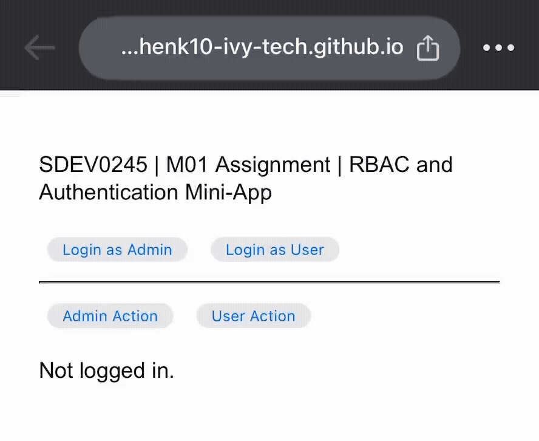

**SDEV | 245**

**M01: Assignment**
 
**Due:** _Monday, Nov 2nd, 2026, by: 10:59pm_

# Module 1: Assignment - RBAC and Authentication Mini-App

[Link to M01 Assignment App Webpage](https://kschenk10-ivy-tech.github.io/SDEV-245/)

## How to use

1. Click "Login as Admin" ➡ Try both action buttons
2. Click "Login as User" ➡ Try both action buttons
3. Try actions without logging in first

> If this were a functional, production-ready application, rather than the wireframe/ basic simulation that it is so far, it would ensure confidentiality by allowing only users with the "admin" role to access this action, and "users" would be denied access to "admin" information, preventing unauthorized viewing or use of protected resources.

---

### Learning Materials

#### Read:

- [x] Webpage: [Geeks for Geeks: What is CIA Triad?](https://www.geeksforgeeks.org/computer-networks/the-cia-triad-in-cryptography/)

- [x] Webpage: [OWASP Cheat Sheet Series - Authentication Cheat Sheet](https://cheatsheetseries.owasp.org/cheatsheets/Authentication_Cheat_Sheet.html)

- [x] Webpage: [OWASP Cheat Sheet Series - Authorization Cheat Sheet](https://cheatsheetseries.owasp.org/cheatsheets/Authorization_Cheat_Sheet.html)

- [x] Webpage: [Authentication vs Authorization](https://www.educba.com/authentication-vs-authorization/)

- [x] Webpage: [Access Control Types and Models](https://identitymanagementinstitute.org/access-control-types-and-models/)

- [x] Webpage: [Access Control Implementation](https://www.forestadmin.com/blog/access-control-implementation/)

- [x] Webpage: [How to implement access control: step by step](https://workos.com/blog/how-to-implement-access-control)

### Watch

- [x] Youtube: [What is the CIA Triad](https://youtu.be/kPPFNrlN3zo?feature=shared)