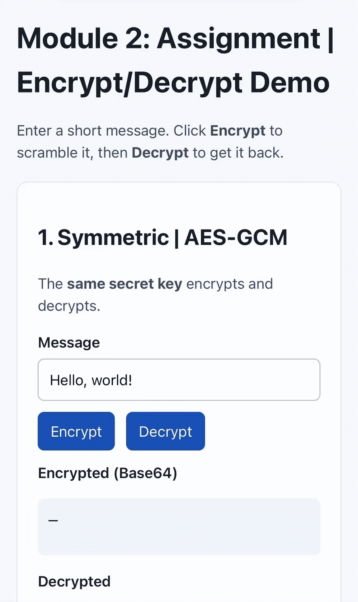

# Module 2: Assignment - Encrypt/Decrypt Demo
***Due: Mon Nov 9, 2026 10:59pm***

---

[Link](./index.html)

*AES-GCM and RSA-OAEP encryption using [Web Crypto API](https://developer.mozilla.org/en-US/docs/Web/API/Web_Crypto_API).*

## Symmetric Encryption (AES-GCM, 256-bit)

Encryption and decryption are paired within the session and triggered by the **Encrypt** / **Decrypt** buttons.

- **Encrypt** (`#symmetricEncrypt`):
  1. Generates a fresh 256-bit AES-GCM key (`crypto.subtle.generateKey`).
  2. Creates a random 12-byte IV (`crypto.getRandomValues`).
  3. Encrypts the text in `#symmetricMessage`.
  4. Displays the ciphertext as Base64 in `#symmetricCipher` and clears the plaintext output.

- **Decrypt** (`#symmetricDecrypt`):
  1. Guards against clicking before encrypting.
  2. Decrypts the stored ciphertext using the same key + IV.
  3. Displays the recovered plaintext in `#symmetricPlain`.

## Asymmetric Encryption (RSA-OAEP, 2048-bit, SHA-256)

Key pair and ciphertext are stored in `rsaKeys` and `rsaCipher`

- **Encrypt** (`#asymmetricEncrypt`):
  1. Generates a 2048-bit RSA-OAEP key pair (public exponent `65537`).
  2. Encrypts the text in `#asymmetricMessage` with the **public** key.
  3. Displays the ciphertext as Base64 in `#asymmetricCipher` and clears the plaintext output.

- **Decrypt** (`#asymmetricDecrypt`):
  1. Guards against clicking before encrypting.
  2. Decrypts the stored ciphertext with the **private** key.
  3. Displays the recovered plaintext in `#asymmetricPlain`.

---

## Module 2: Learning Materials
**Required Content**

Read:

 - [x] Webpage: [What is Cryptography?](https://intellipaat.com/blog/what-is-cryptography-and-algorithms/)
 - [x] Webpage: [Different Types of Cryptography Attacks](https://www.infosectrain.com/blog/different-types-of-cryptography-attacks/)
 - [x] Webpage:  [What is public key infrastructure?](https://www.ibm.com/think/topics/public-key-infrastructure)
 - [x] Webpage: [What Is Public Key Infrastructure (PKI) & How Does It Work?](https://www.okta.com/identity-101/public-key-infrastructure/)
 - [x] Webpage: [Difference Between Symmetric and Asymmetric Key Encryption](https://www.geeksforgeeks.org/computer-networks/difference-between-symmetric-and-asymmetric-key-encryption/)
 - [x] Webpage:  [Encryption Algorithms Explained with Examples](https://www.freecodecamp.org/news/understanding-encryption-algorithms)
 - [x] Webpage:  [Types of Database Encryption Methods](https://www.n-able.com/blog/types-database-encryption-methods "Link")

---

Watch:

 - [x] Youtube:  [How Does HTTPS Work?](https://youtu.be/T4Df5_cojAs?si=bqNSatyJrooebHeE)  [length: 11:01]
 - [x] Youtube:  [Asymmetric Encryption - Simply explained](https://youtu.be/AQDCe585Lnc?si=AS-ZNDQTIYMVBKdc)  [length: 4:40]
  

---

**Extra Content**

 - [x] Webpage:  [Kerberos](https://en.wikipedia.org/wiki/Kerberos_(protocol) "Link")
 - [x] Youtube:  [Kerberos - authentication protocol](https://www.youtube.com/watch?v=_44CHD3Vx-0 "Link")  
    
 - [x] Webpage:  [What Is SSH: Secure Shell Explained](https://phoenixnap.com/kb/what-is-ssh "Link")
 - [x] Youtube:  [Beginners Guide To SSH](https://www.youtube.com/watch?v=qWKK_PNHnnA "Link")  
    
 - [x] Webpage:  [RADIUS (Remote Authentication Dial-In User Service) Protocol](https://www.fortinet.com/resources/cyberglossary/radius-protocol "Link")
 - [x] Youtube:  [AAA framework and RADIUS](https://www.youtube.com/watch?v=feHpDc1cLXM "Link")  
    
 - [x] Webpage:  [Difference between TACACS+ and RADIUS](https://www.geeksforgeeks.org/difference-between-tacacs-and-radius/ "Link")
 - [x] Youtube:  [AAA framework: TACACS+ vs RADIUS](https://www.youtube.com/watch?v=LXd2uP1qKDE "Link")

----

Research, M02 Assignment

Computer Science and Engineering. August 16, 2024. *Optimal asymmetric encryption padding OAEP || Lesson 62 || Cryptography || Learning Monkey ||*. YouTube. https://www.youtube.com/watch?v=YvmLEMb9dKs

Gould, J. September 25, 2019. *Use the Web Crypto API to generate a public / private key pair for end to end, asymmetric cryptography on the web*. DEV Community. https://dev.to/jrgould/use-the-web-crypto-api-to-generate-a-public-private-key-pair-for-end-to-end-asymmetric-cryptography-on-the-web-2mpe

Mozilla. (n.d.). *Web Crypto API*. MDN Web Docs. https://developer.mozilla.org/en-US/docs/Web/API/Web_Crypto_API

NHI Mgmt Group. October 31, 2026. *AES-GCM*. Non-Human Identity & Agentic AI Security. https://nhimg.org/glossary/aes-gcm/

Nießen, T. May 1, 2020. *Securing JavaScript applications with the Web Cryptography API*. IBM Developer. https://developer.ibm.com/articles/secure-javascript-applications-with-web-crypto-api/
