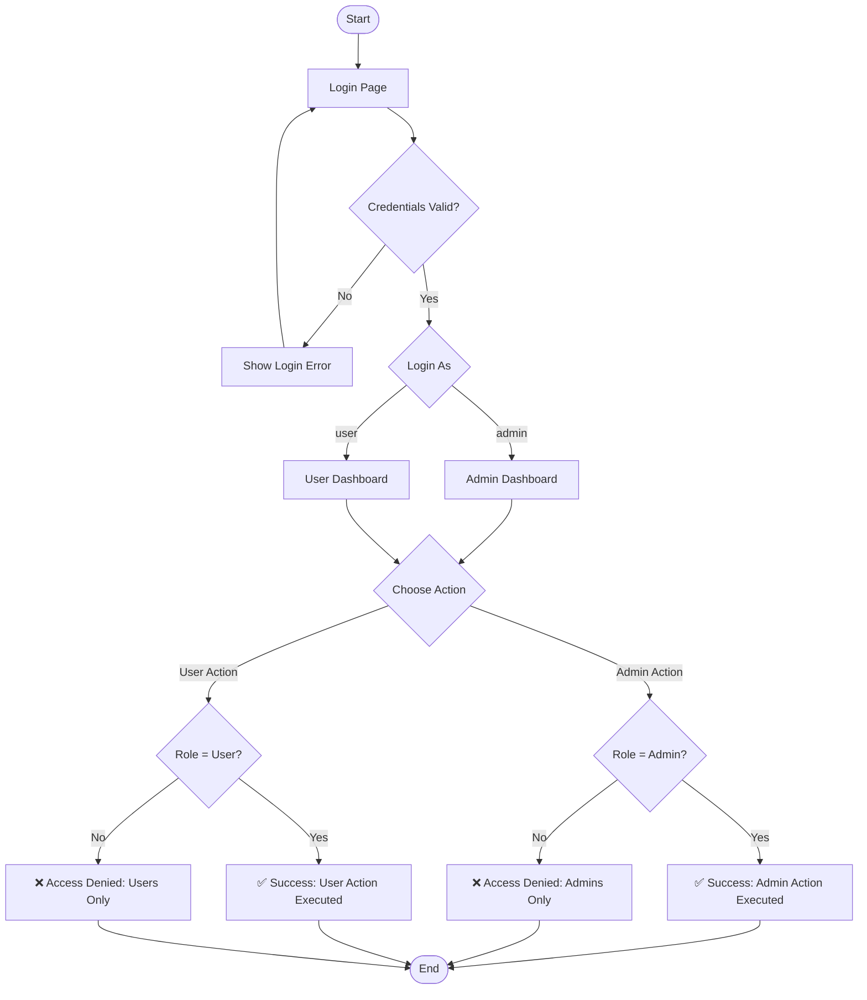

**SDEV | 245**

**M01: Assignment**
 
**Due:** _Monday, Nov 2nd, 2026, by: 10:59pm_

# Module 1: Assignment - RBAC and Authentication Mini-App

[Link to M01 Assignment App Webpage](https://kschenk10-ivy-tech.github.io/SDEV-245/)

## How to use

1. Click "Login as Admin" ➡ Try both action buttons
2. Click "Login as User" ➡ Try both action buttons
3. Try actions without logging in first

If this were a fully developed app instead of just a simulation, it would protect confidentiality by allowing only users with the "admin" role to access certain actions. Users in other roles would be restricted from accessing "admin" information, thus preventing unauthorized viewing or use of protected resources.

- Login as Admin (`admin`) or User (`user`)
- Role-protected actions (Admin Action, User Action)
- Access denial/success message

## The CIA Triad

> **Confidentiality:** Ensures sensitive data is hidden from or inaccessible to unauthorized users (e.g., using encryption, access controls, or multi-factor authentication).

> **Integrity:** Guarantees that data remains accurate, complete, and free from unauthorized alterations or corruption (e.g., using checksums, digital signatures, or version control).

> **Availability:** Ensures that systems, networks, and data are up and running reliably when authorized users need them (e.g., using redundancy, backups, or load balancing).

### Learning Materials

#### Read:

- [x] Webpage: [Geeks for Geeks: What is CIA Triad?](https://www.geeksforgeeks.org/computer-networks/the-cia-triad-in-cryptography/)

- [x] Webpage: [OWASP Cheat Sheet Series - Authentication Cheat Sheet](https://cheatsheetseries.owasp.org/cheatsheets/Authentication_Cheat_Sheet.html)

- [x] Webpage: [OWASP Cheat Sheet Series - Authorization Cheat Sheet](https://cheatsheetseries.owasp.org/cheatsheets/Authorization_Cheat_Sheet.html)

- [x] Webpage: [Authentication vs Authorization](https://www.educba.com/authentication-vs-authorization/)

- [x] Webpage: [Access Control Types and Models](https://identitymanagementinstitute.org/access-control-types-and-models/)

- [x] Webpage: [Access Control Implementation](https://www.forestadmin.com/blog/access-control-implementation/)

- [x] Webpage: [How to implement access control: step by step](https://workos.com/blog/how-to-implement-access-control)

### Watch

- [x] Youtube: [What is the CIA Triad](https://youtu.be/kPPFNrlN3zo?feature=shared)