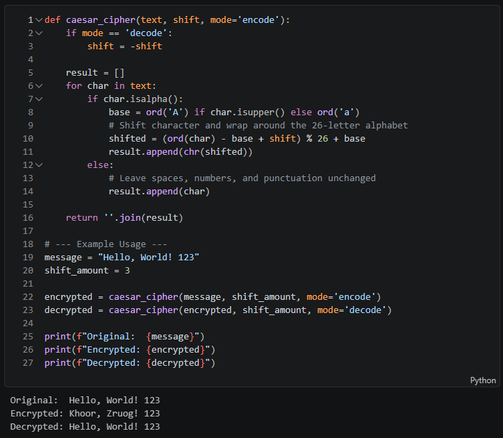

# Module 3: Assignment | Secure Hashing and Encryption

***Due by 10:59pm on: Monday, November 16th, 2026***

## Part One: [SHA-256 Hashing](https://github.com/kschenk10-ivy-tech/SDEV-245/blob/03c956172ae56253dfed44356064afaabb0eec86/Jupyter%20Notebook/Hash.ipynb)

  
Click to expand

> This Jupyter Notebook generates SHA-256 hashes for text or files

### Hash a String
How It Works
- `.encode("utf-8")` converts the string into bytes because SHA-256 hashes bytes, not Python strings.
- `hashlib.sha256()` calculates the hash.
- `.hexdigest()` produces an easy-to-read hexadecimal string.

### Hash a File
Files are already sequences of bytes. Reading in chunks means even large files can be processed without loading them entirely into memory.
 
- `open(path, "rb")` opens the file in read-binary mode.
- `file.read()` gets its bytes.

### A Simple, Interactive App
#### How to Use:
Run the last cell in the Notebook, enter 1 for text, or 2 for a file, and follow the prompt. *For files: supply a path accessible to the notebook’s Python process*

---

## Part Two: [Encoding and Decoding Using the Caesar Cipher](https://github.com/kschenk10-ivy-tech/SDEV-245/blob/03c956172ae56253dfed44356064afaabb0eec86/Jupyter%20Notebook/CaesarCipher.ipynb)

  
Click to expand

  ## How It Works
*This Python script shifts each letter forward or backward through the alphabet using ASCII number conversions and modular arithmetic, while leaving punctuation and spaces untouched.*

- **`ord()` and `chr()`**: Converts letters into their ASCII numbers so you can do math on them, then converts them back into characters.

- **Preserving Case**: Checks `char.isupper()` to set the starting anchor (`base`) at either `'A'` (65) or `'a'` (97).

- **Wrapping (`% 26`)**: The modulo operator ensures that shifting past `'Z'` wraps neatly back around to `'A'`and handles negative shifts automatically when decoding.

- **Non-Letters**: Anything that fails `char.isalpha()` (spaces, numbers, exclamation marks) passes straight through untouched.

(https://github.com/kschenk10-ivy-tech/SDEV-245/blob/0c94822f83d852688bfb6b6611d0fb6eaa672045/Jupyter%20Notebook/CaesarCipher.ipynb "Part Two: Encoding and Decoding Using the Caesar Cipher")

