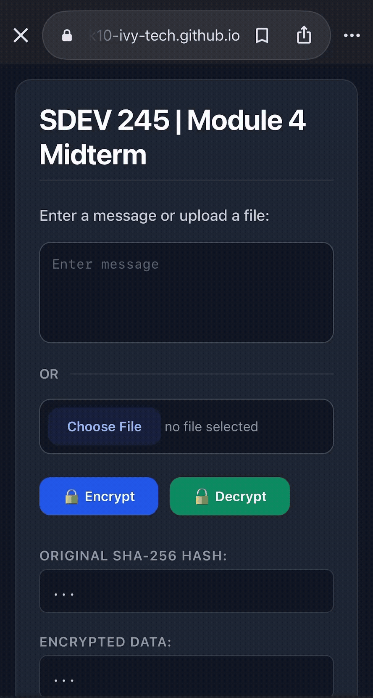

SDEV 245 | M04

## Module 4: Assignment: *Secure Code Analysis*

- [Link to View .pdf File](https://github.com/kschenk10-ivy-tech/SDEV-245/blob/main/M04/SDEV-245_M04-Assignment-Secure-Code-Analysis.pdf)

- [Link to.docx and .pdf Files](https://github.com/kschenk10-ivy-tech/SDEV-245/tree/main/M04)

## Module 4 Midterm: *Build a Secure Data Transmission App with Hashing and Encryption*

- [Link to Module 4 Midterm](https://kschenk10-ivy-tech.github.io/SDEV-245/)

  

---

# Confidentiality, Integrity, and Availability

My implementation for the M04 Midterm demonstrates an appropriate use of cryptographic APIs *(Huigens, 2025; NHI Mgmt Group, 2026)* but does not fully satisfy the Confidentiality, Integrity, and Availability triad for practical, real-world use. While it uses sound cryptographic primitives and provides basic confidentiality and integrity within a single session, it falls short of a complete CIA solution. Availability is the most significant weakness: the absence of persistent key management and storage means encrypted data cannot be reliably recovered or accessed after the session ends.

### **Confidentiality**
My code uses AES-256-GCM with a non-extractable key generated via the WebCrypto API, a cryptographically secure random 96-bit IV, and client-side encryption, so plaintext never leaves the browser. The key, IV, and ciphertext exist only in memory, with no mechanism for persistent storage or key recovery. Confidentiality is therefore limited to a single browser session and does not support secure long-term storage or transmission.

### **Integrity**
AES-GCM provides authenticated encryption: the authentication tag detects any tampering with the ciphertext, and decryption fails outright if the tag does not verify. Comparing hex strings with `===` is not a constant-time comparison, so in principle it could leak timing information (though here both operands are local and the threat is negligible) *(NHI Mgmt Group, 2026; Safeguard, 2026)*. Because the original hash is stored only in memory alongside the key, verification cannot continue across sessions either way.

### **Availability**
My code includes try/catch error handling, runs fully offline with no external dependencies, and supports decrypted file downloads. The dominant availability weakness is that, without persistent key and ciphertext storage, encrypted data is unrecoverable after a page reload, navigation, or browser crash, and because the key is non-extractable, there is no recovery path even in principle. Two additional reliability issues compound this: the Blob URL created in the decrypt handler is never revoked via `URL.revokeObjectURL`, which leaks memory if decryption is repeated *(Foster, 2025; ZeeshanAli-0704, 2026)*; and re-encrypting overwrites the module-level `key`, `iv`, `cipher`, and `originalHash` globals *(mi8bi, 2026)*.

---

#### **References**

Foster, O. December 6, 2025. *Stop abusing Base64: Blob is the right way to unburden the frontend*. Stackademic. https://blog.stackademic.com/stop-abusing-base64-blob-is-the-right-way-to-unburden-the-frontend-f1f1009a7544

Huigens, D. April 22, 2025. *Web Cryptography Level 2 (W3C First Public Working Draft)*. World Wide Web Consortium. https://www.w3.org/TR/webcrypto-2/

mi8bi. July 19, 2026. *Building an AES encrypt/decrypt tool with nothing but the Web Crypto API*. DEV Community. https://dev.to/mi8bi/building-an-aes-encryptdecrypt-tool-with-nothing-but-the-web-crypto-api-d93

Non-Human Identity Management Group. October 29, 2026. *What a cryptographic API does*. https://nhimg.org/glossary/cryptographic-api/

Non-Human Identity Management Group. October 31, 2026. *Constant-time comparison*. https://nhimg.org/glossary/constant-time-comparison/

Safeguard. October 18, 2026. *Compare secrets in constant time: Why == is the wrong check*. https://safeguard.sh/resources/blog/constant-time-comparison-for-secrets-and-signatures

ZeeshanAli-0704. October 17, 2026. *Frontend memory leaks — Detection, diagnosis and prevention*. DEV Community. https://dev.to/zeeshanali0704/frontend-memory-leaks-detection-diagnosis-and-prevention-2j8m

---
